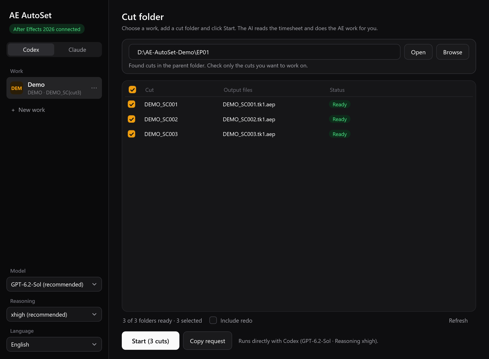
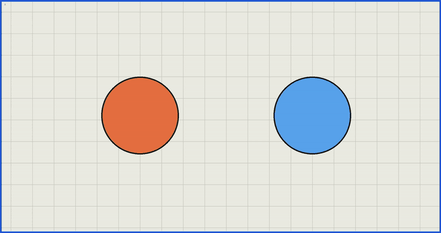
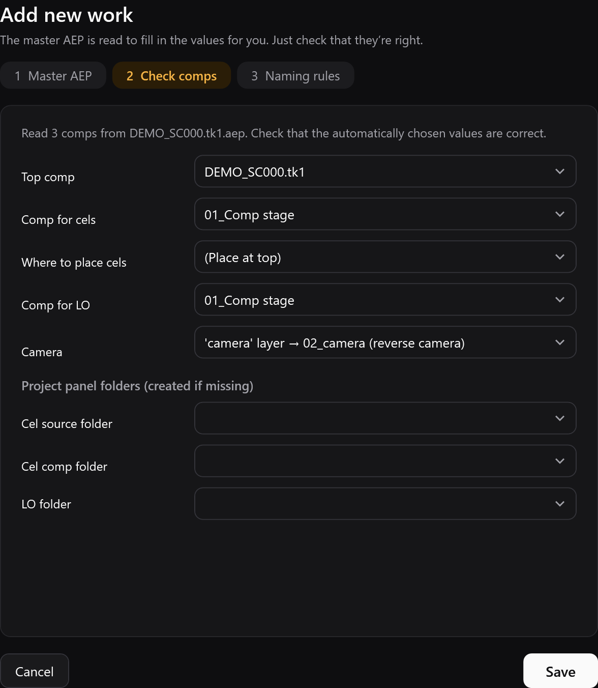

# AE AutoSet

**タイムシートを入れると、After Effects のカットができあがります。** 
AI(Codex または Claude Code)がタイムシートを読み取り、After Effects がセルのタイミング・LO・カメラを組んで、
カットごとに新しい AEP として保存します。

[**ダウンロード**](https://github.com/fjrzl0954/AE-AutoSet/archive/refs/heads/main.zip) ·
[使い方](READ%20ME.txt) ·
[不具合の報告](https://github.com/fjrzl0954/AE-AutoSet/issues/new/choose) ·
[フィードバック](#フィードバック)

[English](README.md) · [한국어](README.ko.md) · **日本語** · [简体中文](README.zh-CN.md)

---

## できること

- **AI がタイムシートを読み取ります。** シート画像からセル欄、止め、フレーム数、カメラ指示を読み取ります。
  ご自身の Codex または Claude Code のプランを使い、API キーは不要です。
- **After Effects でカットを組みます。** 別の After Effects が起動して作品の原本 AEP にセルと LO を配置し、
  タイミングとカメラのキーを適用して `<カット>.tk1.aep` を保存し、自動で閉じます。
  いま使っている After Effects や、保存していない作業には触れません。
- **どの作品でも、いつものフォルダー構成で。** 原本 AEP から作品を一度登録すると、ウィンドウがコンポを読み取り、
  セル・LO の配置先やカットフォルダーの名前の規則を提案します。
- **4か国語対応。** ウィンドウは English・한국어・日本語・简体中文 から選べ(左下)、結果メモも同じ言語で書かれます。

 
DEMO カットの実行結果: シートに書かれたフレームで A セルが替わり、カメラが寄ります。

## 必要な環境

- Windows 10/11
- Adobe After Effects 2025 以降
- ログイン済みの [Codex CLI](https://github.com/openai/codex) または [Claude Code](https://claude.com/claude-code)
- DEMO のカメラ用に、無料プラグイン [F's Plugins](https://github.com/bryful/F-s-PluginsProjects)(MIT)の `F's Frame.aex`。
  Releases にある旧 *F's Plugins* のパッケージ(`FsPlugins*.zip`)に入っています(新しい NF-Plugins にはありません)。
  `C:\Program Files\Adobe\Adobe After Effects <バージョン>\Support Files\Plug-ins\` にコピーし、After Effects を再起動してください。

## インストール

1. [ZIP をダウンロード](https://github.com/fjrzl0954/AE-AutoSet/archive/refs/heads/main.zip)するか、クローンします:
   `git clone https://github.com/fjrzl0954/AE-AutoSet.git`
2. フォルダー名を `AE-AutoSet` にして、AI のスキルフォルダーに置きます(ZIP の場合は `AE-AutoSet-main` の名前を変えます)。
   - Codex: `%USERPROFILE%\.agents\skills\AE-AutoSet`
   - Claude Code: `%USERPROFILE%\.claude\skills\AE-AutoSet`
3. **`AE AutoSet.cmd`** を一度ダブルクリックします。ウィンドウが開き、デスクトップとスタートメニューにショートカットができます。

詳しい使い方は [`READ ME.txt`](READ%20ME.txt) に4か国語で入っています。

## 使い方

まずは同梱の **DEMO 作品**で試してください(`assets/AE-AutoSet_TeamKit/projects/DEMO`)。
素材なしで一から作った原本(ステージ、`02_camera` 出力、F's Frame で枠を描いた 2D `camera` リグ)です。
カットフォルダーを `DEMO_SC001` という名前にし、`sheet/`、`LO/`、セルフォルダー(`A/A0001.png` など)を入れて実行します。
同じフォルダーの `make_demo_template.jsx` で原本を作り直せます。

1. **作品の登録**(作品ごとに一度): 左の *+ 新しい作品* → 000カットの原本 AEP と、できれば実際のカットフォルダーを一つ選びます。
   提案されたコンポと名前の規則を確認します。
2. **カットを選ぶ**: 左で作品を選び、カットフォルダーまたは上位フォルダーをドラッグ&ドロップして、作業するカットにチェックを入れます。
3. **作業開始**: Codex か Claude を選んで *作業開始* をクリックします。カットごとに AEP が保存され、確認が必要なときは短いメモが残ります。
   結果があるカットをやり直すには、カット一覧の下の *やり直しを含める* をオンにします。

 
作品の登録: コンポ、セルの配置、カメラを原本 AEP から読み取ります(画面は英語設定)。

## 補足

- **費用。** AI の利用量はご自身のプランから消費されます。一度に複数カットを入れるほど、1カットあたりの消費は減ります。
  低いモデルや低い推論は安く済みますが、シートを読み違えることがあります。
- **プライバシー。** 作業したカットのシート・LO 画像は、ご自身のアカウントで選んだ AI サービス(Codex または Claude)に送信されます。
- **形式。** 日本式のアニメ用タイムシートと、セル/LO のフォルダー構成を前提にしています。
- **カメラリグ。** カメラは `camera` レイヤーの F's Frame から画面サイズを読み取ります。自分で登録した作品では
  プラグインは必須ではなく、その場合は出力コンポ(`02_camera`)のサイズを使います。
- **クラッシュ画面。** After Effects が前回異常終了していた場合、作業用 AE に出る *Crash Repair Options* で
  自動的に *Continue* を選びます。
- 登録した作品、原本 AEP、設定は各自の PC にだけ保存されます。

## フィードバック

不具合、質問、アイデアは [Issues](https://github.com/fjrzl0954/AE-AutoSet/issues/new/choose) へどうぞ。
*Bug report* または *Feature request* を選び、メモファイルの内容とウィンドウに出たエラーを貼り付けてください。
**公開ページのため、実際の作品のシート・セル・LO・AEP は添付しないでください。** 画像が必要なときは DEMO 作品を使ってください。

## ライセンス

[MIT](LICENSE)。サードパーティーの表記: `assets/AE-AutoSet_TeamKit/licenses/THIRD_PARTY_LICENSES.md`。
After Effects は Adobe の商標です。このプロジェクトは Adobe、OpenAI、Anthropic とは関係ありません。
