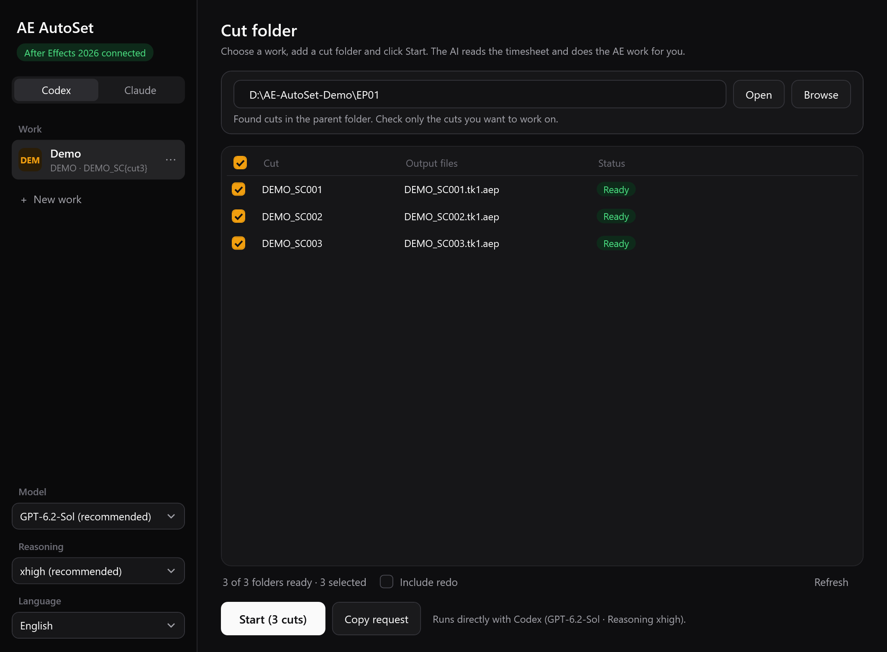
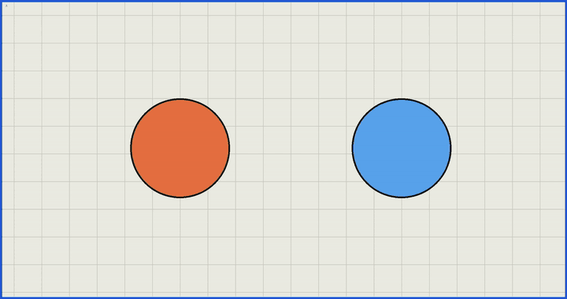
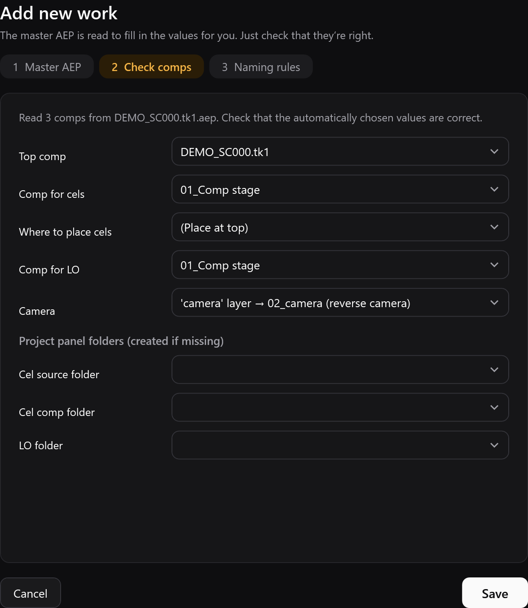

# AE AutoSet

**타임시트를 넣으면 After Effects 컷이 나와요.** 
AI(Codex 또는 Claude Code)가 타임시트를 읽고, After Effects가 셀 타이밍·LO·카메라를 세팅해
컷마다 새 AEP로 저장해요.

[**다운로드**](https://github.com/fjrzl0954/AE-AutoSet/archive/refs/heads/main.zip) ·
[사용 안내](READ%20ME.txt) ·
[오류 신고](https://github.com/fjrzl0954/AE-AutoSet/issues/new/choose) ·
[피드백](#피드백)

[English](README.md) · **한국어** · [日本語](README.ja.md) · [简体中文](README.zh-CN.md)

---

## 하는 일

- **AI가 타임시트를 읽어요.** 시트 이미지에서 셀 칸, 홀드, 프레임 수, 카메라 지시를 읽어요.
  본인의 Codex 또는 Claude Code 요금제를 쓰고, API 키는 필요 없어요.
- **After Effects에서 컷을 만들어요.** 별도의 After Effects가 열려 작품의 양식 AEP에 셀과 LO를 배치하고,
  타이밍과 카메라 키를 적용해 `<컷>.tk1.aep`로 저장한 뒤 스스로 닫혀요.
  지금 쓰고 있는 After Effects와 저장 안 한 작업은 건드리지 않아요.
- **어떤 작품이든, 내 폴더 규칙대로.** 양식 AEP로 작품을 한 번 등록하면 창이 컴프를 읽어서
  셀·LO 위치와 컷 폴더 이름 규칙을 제안해요.
- **4개 언어.** 창은 English·한국어·日本語·简体中文 중에서 고를 수 있고(왼쪽 아래), 결과 메모도 같은 언어로 적혀요.

 
DEMO 컷 실행 결과: 시트에 적힌 프레임에서 A셀이 바뀌고 카메라가 다가가요.

## 필요 환경

- Windows 10/11
- Adobe After Effects 2025 이상
- 로그인된 [Codex CLI](https://github.com/openai/codex) 또는 [Claude Code](https://claude.com/claude-code)
- DEMO 카메라용 무료 플러그인 [F's Plugins](https://github.com/bryful/F-s-PluginsProjects)(MIT)의 `F's Frame.aex`.
  Releases의 예전 *F's Plugins* 묶음(`FsPlugins*.zip`)에 들어 있어요(새 NF-Plugins에는 없어요).
  `C:\Program Files\Adobe\Adobe After Effects <버전>\Support Files\Plug-ins\`에 넣고 After Effects를 다시 켜세요.

## 설치

1. [ZIP을 내려받거나](https://github.com/fjrzl0954/AE-AutoSet/archive/refs/heads/main.zip) 복제해요:
   `git clone https://github.com/fjrzl0954/AE-AutoSet.git`
2. 폴더 이름을 `AE-AutoSet`으로 해서 스킬 폴더에 넣어요(ZIP이면 `AE-AutoSet-main`의 이름을 바꿔요).
   - Codex: `%USERPROFILE%\.agents\skills\AE-AutoSet`
   - Claude Code: `%USERPROFILE%\.claude\skills\AE-AutoSet`
3. **`AE AutoSet.cmd`**를 한 번 두 번 눌러요. 창이 열리고 바탕화면·시작 메뉴에 바로가기가 생겨요.

자세한 안내는 [`READ ME.txt`](READ%20ME.txt)에 4개 언어로 들어 있어요.

## 사용

처음에는 포함된 **DEMO 작품**으로 시험해 보세요(`assets/AE-AutoSet_TeamKit/projects/DEMO`).
소스 없이 새로 만든 양식(스테이지, `02_camera` 출력, F's Frame으로 틀을 그린 2D `camera` 리그)이에요.
컷 폴더 이름을 `DEMO_SC001`로 하고 `sheet/`, `LO/`, 셀 폴더(`A/A0001.png` 등)를 넣은 뒤 실행하면 돼요.
같은 폴더의 `make_demo_template.jsx`로 양식을 다시 만들 수 있어요.

1. **작품 등록**(작품마다 한 번): 왼쪽 *+ 새 작품* → 000컷 양식 AEP와, 가능하면 실제 컷 폴더 하나를 골라요.
   제안된 컴프와 이름 규칙을 확인해요.
2. **컷 고르기**: 왼쪽에서 작품을 고르고, 컷 폴더나 상위 폴더를 끌어다 놓은 뒤 작업할 컷을 체크해요.
3. **작업 시작**: Codex나 Claude를 고르고 *작업 시작*을 눌러요. 컷마다 AEP가 저장되고, 확인할 것이 있으면 짧은 메모가 남아요.
   이미 결과가 있는 컷을 다시 하려면 컷 목록 아래 *재작업 포함*을 켜요.

 
작품 등록: 컴프, 셀 위치, 카메라를 양식 AEP에서 읽어 와요. (화면은 영어 설정)

## 참고

- **비용.** AI 사용량은 본인 요금제에서 나가요. 한 번에 여러 컷을 넣을수록 컷당 사용량이 줄어요.
  낮은 모델이나 낮은 추론은 저렴하지만 시트를 잘못 읽을 수 있어요.
- **개인정보.** 작업한 컷의 시트·LO 이미지는 본인 계정으로 고른 AI 서비스(Codex 또는 Claude)에 전송돼요.
- **형식.** 일본식 애니 타임시트와 셀/LO 폴더 구성을 기준으로 만들었어요.
- **카메라 리그.** 카메라는 `camera` 레이어의 F's Frame에서 화면 크기를 읽어요. 직접 등록한 작품에서는
  플러그인이 없어도 되고, 그때는 출력 컴프(`02_camera`) 크기를 써요.
- **크래시 창.** After Effects가 전에 비정상 종료됐다면, 작업용 AE에 뜨는 *Crash Repair Options* 창에서
  자동으로 *Continue*를 눌러요.
- 등록한 작품, 양식 AEP, 설정은 각자 PC에만 저장돼요.

## 피드백

오류, 질문, 아이디어는 [Issues](https://github.com/fjrzl0954/AE-AutoSet/issues/new/choose)에 남겨 주세요.
*Bug report* 또는 *Feature request*를 고르고, 메모 파일 내용과 창에 나온 오류를 붙여 넣어 주세요.
**공개 페이지라서 실제 작품의 시트·셀·LO·AEP는 올리지 마세요.** 그림이 필요하면 DEMO 작품을 써 주세요.

## 라이선스

[MIT](LICENSE). 외부 구성 요소 고지: `assets/AE-AutoSet_TeamKit/licenses/THIRD_PARTY_LICENSES.md`.
After Effects는 Adobe의 상표예요. 이 프로젝트는 Adobe, OpenAI, Anthropic과 관련이 없어요.
