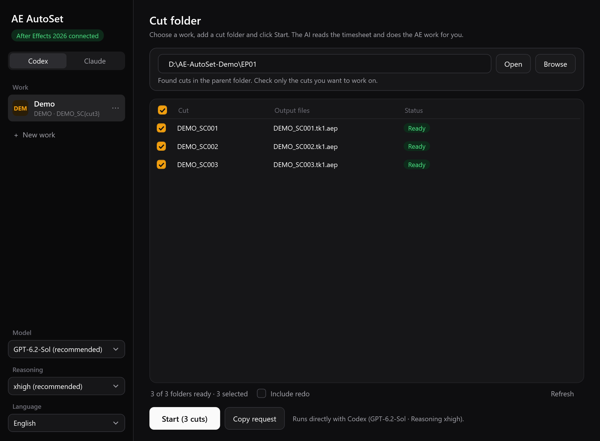
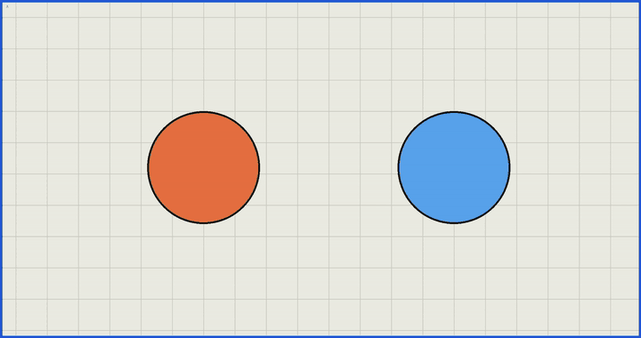
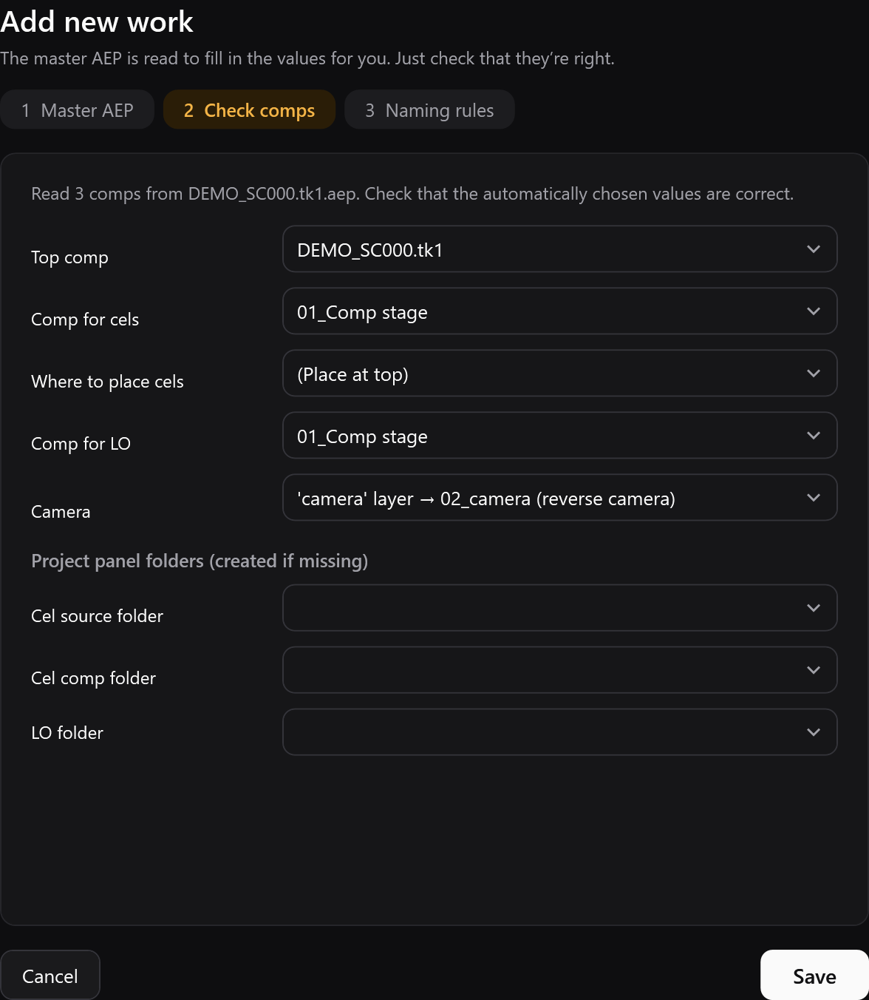

# AE AutoSet

**Anime timesheets in, After Effects cuts out.** 
An AI agent (Codex or Claude Code) reads each timesheet, then After Effects sets up
cel timing, layout and camera, and saves a new AEP for every cut.

[**Download**](https://github.com/fjrzl0954/AE-AutoSet/archive/refs/heads/main.zip) ·
[Guide](READ%20ME.txt) ·
[Bug reports](https://github.com/fjrzl0954/AE-AutoSet/issues/new/choose) ·
[Feedback](#feedback)

**English** · [한국어](README.ko.md) · [日本語](README.ja.md) · [简体中文](README.zh-CN.md)

---

## What it does

- **Reads timesheets with AI.** The agent reads each sheet image (cel columns, holds, frame counts,
  camera notes). You use your own Codex or Claude Code subscription; no API keys.
- **Builds the cut in After Effects.** A separate After Effects instance opens the work's master AEP,
  places cels and layout, applies the timing and camera keys, saves `<cut>.tk1.aep`, and closes.
  Your own open After Effects and its unsaved work are never touched.
- **Any work, your naming.** Register a work once from its master AEP; the window reads the comps and
  suggests where cels and layout go and how cut folders are named.
- **Four languages.** The window works in English, Korean, Japanese or Simplified Chinese (switch at the
  bottom left), and worker notes are written in the same language.

 
The DEMO cut after a run: cel A changes on the frame the sheet says, and the camera pushes in.

## Requirements

- Windows 10/11
- Adobe After Effects 2025 or later
- [Codex CLI](https://github.com/openai/codex) or [Claude Code](https://claude.com/claude-code), signed in
- [F's Plugins](https://github.com/bryful/F-s-PluginsProjects) (free, MIT): `F's Frame.aex` for the DEMO camera rig.
  It is in the older *F's Plugins* packages (`FsPlugins*.zip` on the Releases page), not in the newer NF-Plugins.
  Copy it into `C:\Program Files\Adobe\Adobe After Effects <version>\Support Files\Plug-ins\` and restart After Effects.

## Install

1. [Download the ZIP](https://github.com/fjrzl0954/AE-AutoSet/archive/refs/heads/main.zip) or clone:
   `git clone https://github.com/fjrzl0954/AE-AutoSet.git`
2. Put the folder where your AI agent finds skills, named `AE-AutoSet` (rename `AE-AutoSet-main` if you used the ZIP):
   - Codex: `%USERPROFILE%\.agents\skills\AE-AutoSet`
   - Claude Code: `%USERPROFILE%\.claude\skills\AE-AutoSet`
3. Double-click **`AE AutoSet.cmd`** once. It opens the window and adds a desktop / Start menu shortcut.

The full guide (English, Korean, Japanese, Simplified Chinese) is in [`READ ME.txt`](READ%20ME.txt).

## Use

**Try the DEMO work first.** A neutral `DEMO` work is included (`assets/AE-AutoSet_TeamKit/projects/DEMO`):
a master AEP built from scratch (stage, `02_camera` output, a 2D `camera` rig framed by F's Frame) with no
footage. Name a cut folder `DEMO_SC001` with `sheet/`, `LO/` and cel folders such as `A/A0001.png`, then run it.
`make_demo_template.jsx` in the same folder rebuilds the master.

1. **Register your work** (once per work): *+ New work* → choose the master AEP (the empty cut-000
   template) and, if you can, one real cut folder. Confirm the suggested comps and naming.
2. **Pick cuts**: select the work on the left, drop a cut folder or a parent folder of cuts, check the cuts.
3. **Start**: choose Codex or Claude and press *Start*. Each cut gets its AEP and, when something needs a look, a short worker note.
   To redo cuts that already have results, turn on *Include redo* below the cut list.

 
Adding a work: the comps, cel position and camera are read from the master AEP.

## Notes

- **Cost.** Each run uses your AI plan. Several cuts per run cost less per cut than one cut per run.
  Lower models or reasoning levels are cheaper but may misread sheets.
- **Privacy.** Sheet and layout images of the cuts you run are sent to the AI service you choose
  (Codex or Claude), under your own account.
- **Format.** Built around Japanese-style anime timesheets and cel/LO folder layouts.
- **Camera rig.** The camera reads its frame size from F's Frame on the `camera` layer. In your own works
  the plug-in is optional: without it the output comp (`02_camera`) defines the frame.
- **Crash dialog.** If After Effects crashed before, the separate instance answers its
  *Crash Repair Options* dialog with *Continue* automatically.
- Your registered works, master AEPs and settings stay on your PC.

## Feedback

Bugs, questions and ideas go to [Issues](https://github.com/fjrzl0954/AE-AutoSet/issues/new/choose):
pick *Bug report* or *Feature request*. Paste the text of the note files and any error the window showed.
**The page is public: don't attach timesheets, cels, LO or AEPs from real works.** Use the DEMO work instead.

## License

[MIT](LICENSE). Third-party notices: `assets/AE-AutoSet_TeamKit/licenses/THIRD_PARTY_LICENSES.md`.
After Effects is a trademark of Adobe. This project is not affiliated with Adobe, OpenAI or Anthropic.
