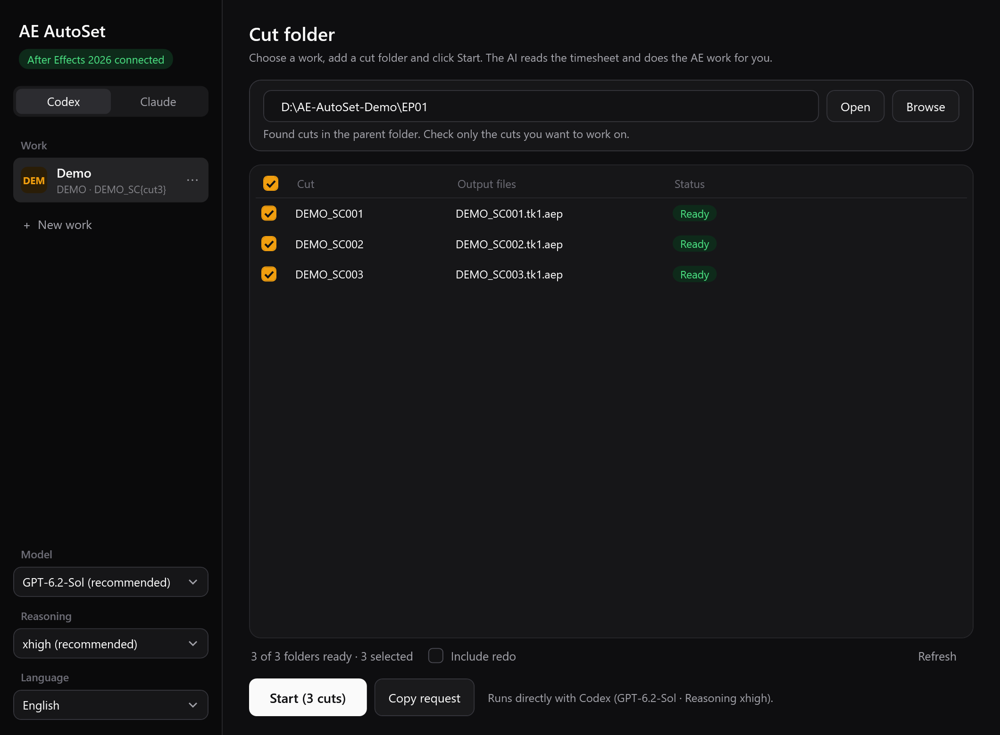
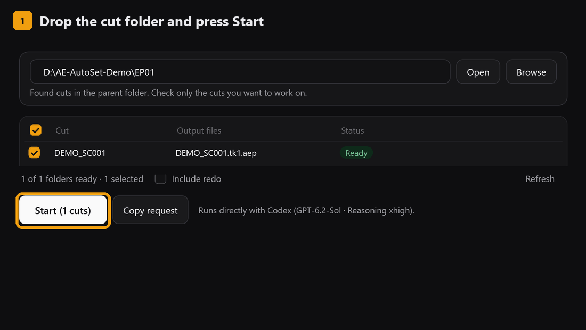
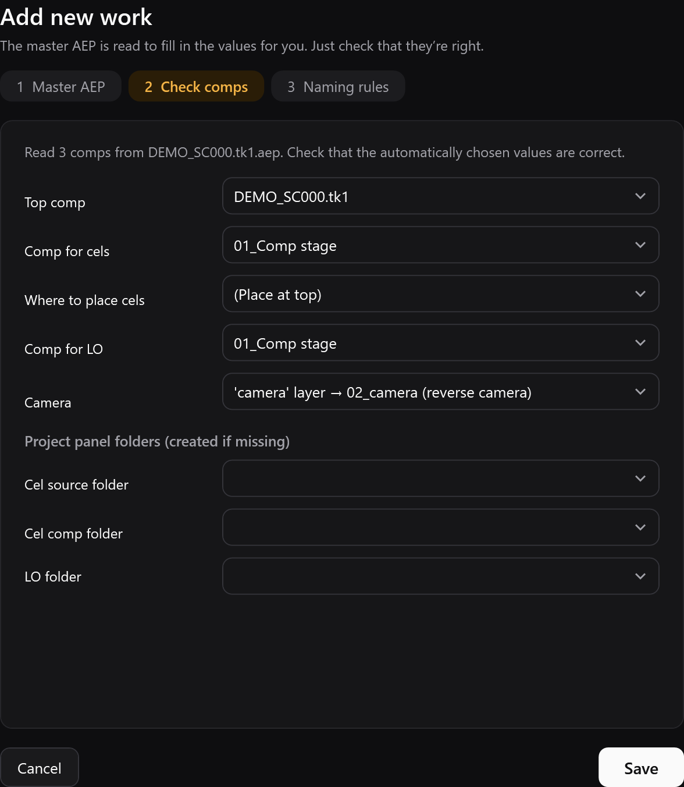

# AE AutoSet

**放入摄影表，得到 After Effects 镜头。** 
AI（Codex 或 Claude Code）读取摄影表，After Effects 设置动画层时间、LO 和摄像机，
并为每个镜头保存新的 AEP。

[**下载**](https://github.com/fjrzl0954/AE-AutoSet/archive/refs/heads/main.zip) ·
[使用说明](../READ%20ME.txt) ·
[问题反馈](https://github.com/fjrzl0954/AE-AutoSet/issues/new/choose) ·
[反馈](#反馈)

[English](../README.md) · [한국어](README.ko.md) · [日本語](README.ja.md) · **简体中文**

---

## 功能

- **AI 读取摄影表。** 从摄影表图片中读取动画层栏、停格、帧数和摄像机指示。
  使用你自己的 Codex 或 Claude Code 订阅，无需 API 密钥。
- **在 After Effects 中搭建镜头。** 另开一个 After Effects，在作品的模板 AEP 中放置动画层和 LO，
  应用时间和摄像机关键帧，保存为 `<镜头>.tk1.aep` 后自动关闭。
  不会改动你正在使用的 After Effects 及其未保存的内容。
- **任何作品，按你的命名。** 用模板 AEP 注册一次作品，窗口会读取合成，
  并建议动画层和 LO 的位置以及镜头文件夹的命名规则。
- **四种语言。** 窗口可选 English、한국어、日本語、简体中文（左下角），结果备注也会使用同一语言。

 
示例镜头的实际运行，以及摄影表与结果的对照：A 眨眼（第25–31帧），B 挥手（37–60）， 
摄像机从 A 框推近到 B 框（T.U.，13–48），都与摄影表一致。

## 运行环境

- Windows 10/11
- Adobe After Effects 2025 及以上
- 已登录的 [Codex CLI](https://github.com/openai/codex) 或 [Claude Code](https://claude.com/claude-code)
- DEMO 摄像机需要免费插件 [F's Plugins](https://github.com/bryful/F-s-PluginsProjects)（MIT）中的 `F's Frame.aex`。
  它在 Releases 中旧版 *F's Plugins* 的压缩包（`FsPlugins*.zip`）里，新的 NF-Plugins 中没有。
  复制到 `C:\Program Files\Adobe\Adobe After Effects <版本>\Support Files\Plug-ins\`，然后重启 After Effects。

## 安装

1. [下载 ZIP](https://github.com/fjrzl0954/AE-AutoSet/archive/refs/heads/main.zip) 或克隆：
   `git clone https://github.com/fjrzl0954/AE-AutoSet.git`
2. 将文件夹命名为 `AE-AutoSet`，放到 AI 的技能文件夹中（使用 ZIP 时请把 `AE-AutoSet-main` 改名）：
   - Codex：`%USERPROFILE%\.agents\skills\AE-AutoSet`
   - Claude Code：`%USERPROFILE%\.claude\skills\AE-AutoSet`
3. 双击一次 **`AE AutoSet.cmd`**。窗口会打开，并在桌面和开始菜单创建快捷方式。

完整说明（四种语言）见 [`READ ME.txt`](../READ%20ME.txt)。

## 使用

建议先用**示例镜头**试一试。自带的 `DEMO` 作品附有一个可直接运行的镜头
`assets/AE-AutoSet_TeamKit/projects/DEMO/DEMO_SC001`（为本仓库绘制的摄影表、LO 和动画层）。
把这个文件夹复制到任意位置（桌面上的新文件夹也可以），在左侧选择 *Demo*，拖入文件夹后点击 *开始处理*。
DEMO 模板 AEP（舞台、`02_camera` 输出、用 F's Frame 画出画框的 2D `camera` 绑定）不含素材，
可用同一文件夹中的 `make_demo_template.jsx` 重新生成。

1. **注册作品**（每个作品一次）：左侧 *+ 新建作品* → 选择 000 镜头的模板 AEP，如有可能再选一个实际的镜头文件夹。
   确认建议的合成和命名规则。
2. **选择镜头**：在左侧选择作品，拖入镜头文件夹或其上级文件夹，勾选要处理的镜头。
3. **开始处理**：选择 Codex 或 Claude，点击 *开始处理*。每个镜头都会保存 AEP，需要确认时会留下简短备注。
   要重做已有结果的镜头，请打开镜头列表下方的 *包含重做*。

 
注册作品：从模板 AEP 读取合成、动画层位置和摄像机（截图为英文界面）。

## 说明

- **费用。** 每次运行消耗你自己的 AI 额度。一次放入的镜头越多，每个镜头的消耗越少。
  较低的模型或推理更省额度，但可能误读摄影表。
- **隐私。** 所处理镜头的摄影表和 LO 图片会以你自己的账号发送到你选择的 AI 服务（Codex 或 Claude）。
- **格式。** 以日式动画摄影表和动画层/LO 文件夹结构为前提。
- **摄像机绑定。** 摄像机从 `camera` 图层上的 F's Frame 读取画面尺寸。自己注册的作品可以不用该插件，
  此时以输出合成（`02_camera`）的尺寸为准。
- **崩溃对话框。** 如果 After Effects 之前异常退出，处理用的 AE 会在 *Crash Repair Options* 对话框中
  自动选择 *Continue*。
- 注册的作品、模板 AEP 和设置只保存在各自的电脑上。

## 反馈

问题、疑问和建议请提交到 [Issues](https://github.com/fjrzl0954/AE-AutoSet/issues/new/choose)。
选择 *Bug report* 或 *Feature request*，并粘贴备注文件内容和窗口中出现的错误。
**这是公开页面，请勿附上实际作品的摄影表、动画层、LO 或 AEP。** 需要图片时请使用 DEMO 作品。

## 许可证

[MIT](../LICENSE)。第三方声明：`assets/AE-AutoSet_TeamKit/licenses/THIRD_PARTY_LICENSES.md`。
After Effects 是 Adobe 的商标。本项目与 Adobe、OpenAI、Anthropic 无关。
